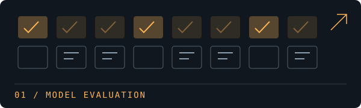
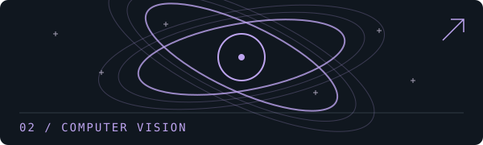
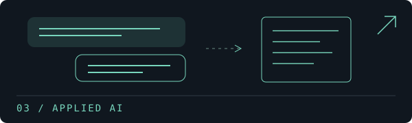
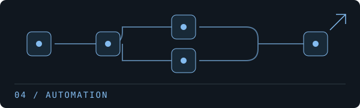
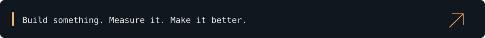

  

  <a href="https://kanishqgandharv.vercel.app"><b>Portfolio ↗</b></a>
  &nbsp;&nbsp; / &nbsp;&nbsp;
  <a href="https://www.linkedin.com/in/kanishq-gandharv007/"><b>LinkedIn ↗</b></a>
  &nbsp;&nbsp; / &nbsp;&nbsp;
  <a href="https://github.com/KanishqGandharv219?tab=repositories"><b>All projects ↗</b></a>

### Models are interesting. What they actually do is more interesting.

I'm Kanishq, an AI/ML developer studying **MSc Advanced Computer Science (AI) at the University of Leeds**. My projects span language-model evaluation, computer vision and apps that put models to work.

I like experiments with something to inspect: the code, the evaluation, the result.

 

## Selected work

<table>
<tr>
<td width="50%" valign="top">

<h3><a href="https://github.com/KanishqGandharv219/open-factual-bench">Open Factual Bench ↗</a></h3>

A factuality and hallucination benchmark for small language models, with structured runs and an HTML leaderboard.

<code>Python</code> <code>LLM evaluation</code>

<a href="https://kanishqgandharv219.github.io/open-factual-bench/">Explore the benchmark →</a>

</td>
<td width="50%" valign="top">

<h3><a href="https://github.com/KanishqGandharv219/unsupervised-sr-sandbox">DeepLense-SR ↗</a></h3>

Exploring unsupervised and physics-informed super-resolution for gravitational lensing images.

<code>Computer vision</code> <code>Scientific ML</code>

<a href="https://github.com/KanishqGandharv219/unsupervised-sr-sandbox">Inspect the experiments →</a>

</td>
</tr>
<tr>
<td width="50%" valign="top">

<h3><a href="https://github.com/KanishqGandharv219/help-yourself-mental-health-app">Help Yourself ↗</a></h3>

An Android wellness app with a RAG chat assistant and a Python backend.

<code>Kotlin</code> <code>Python</code> <code>RAG</code>

<a href="https://github.com/KanishqGandharv219/help-yourself-mental-health-app">Explore the application →</a>

</td>
<td width="50%" valign="top">

<h3><a href="https://github.com/KanishqGandharv219/N8N-Automation-Suite">n8n Automation Suite ↗</a></h3>

A collection of n8n workflows for lead generation and qualification.

<code>n8n</code> <code>JavaScript</code> <code>Workflows</code>

<a href="https://github.com/KanishqGandharv219/N8N-Automation-Suite">Browse the workflows →</a>

</td>
</tr>
</table>

 

## What I'm working toward

**Reliable AI:** evaluating model outputs, building retrieval workflows and making experiments easier to reproduce.

**Open source:** contributing focused fixes and regression tests to scientific Python projects. [See my pull requests →](https://github.com/pulls?q=is%3Apr+author%3AKanishqGandharv219+archived%3Afalse)

**What's next:** research opportunities and 2027 graduate roles in AI and machine learning.

 

  

